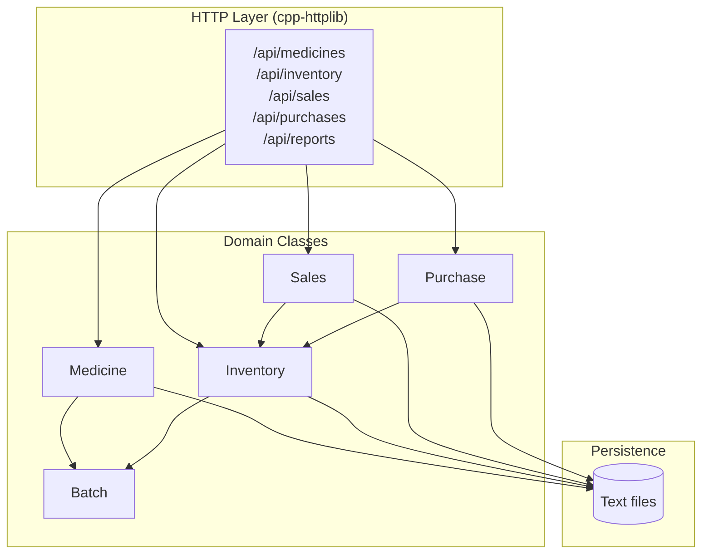
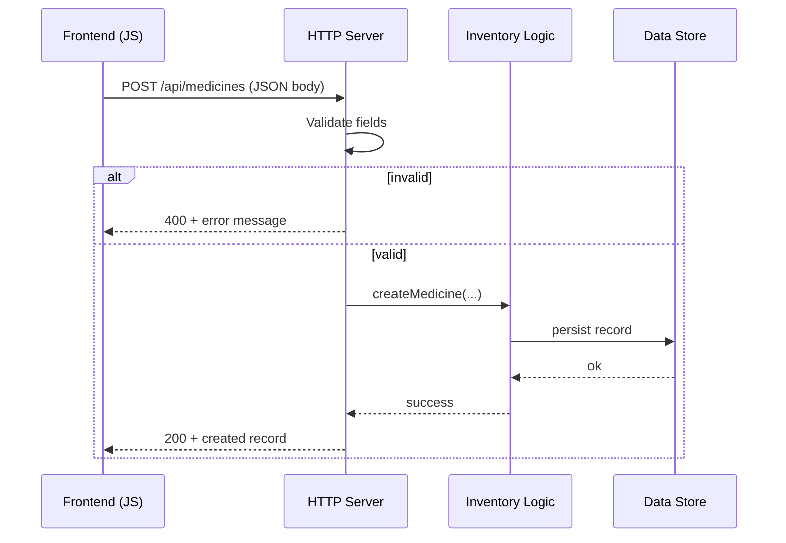

# Pharmatrix AI — Backend

C++ business-logic core for the Pharmatrix AI pharmacy inventory and operations platform. The backend owns all validation, inventory rules, sales/purchase processing, and data persistence; it exposes its functionality to the [frontend](../Frontend/readme.md) over local HTTP endpoints.

> See the [project-level README](../readme.md) and [`Pharmatrix_AI_Project_Report.pdf`](../Pharmatrix_AI_Project_Report.pdf) for full context, roadmap, and business rules.

## Responsibilities

- Validate all incoming requests before touching data.
- Own the business rules for medicines, batches, inventory, sales, and purchases.
- Enforce FEFO (First Expiry, First Out) batch selection.
- Persist data to local text files — no database is used.
- Serve JSON over HTTP to the frontend via `cpp-httplib`.
- Expose controlled, approved functions for the AI service to call as tools — never raw file/DB access.

## Architecture



## Planned Module Layout

```
Backend/
├── main.cpp              # HTTP server bootstrap & routing
├── Medicine.h / .cpp      # Medicine records
├── Batch.h / .cpp         # Batch-level stock (qty, price, expiry)
├── Inventory.h / .cpp     # Stock rules, reorder thresholds, FEFO
├── Sales.h / .cpp         # Sale recording, batch deduction
├── Purchase.h / .cpp      # Supplier & purchase recording
├── httplib.h              # Vendored HTTP library
└── readme.md
```

## Core Business Rules

- A sale must never reduce stock below zero.
- Every completed sale and purchase creates a transaction record.
- Stock deduction and sales recording succeed or fail together, written to the text-file store as a single atomic step.
- Expired batches are blocked from normal sale per approved policy.
- FEFO = select the eligible batch with the earliest expiry date first.
- Every stock adjustment records who made the change, when, and why.

## Example Endpoint Flow — `POST /api/medicines`



## Development Status

Currently in **Phase 1 — C++ console foundation**: classes, encapsulation, STL containers, file handling, and exception handling for Medicine CRUD before HTTP/database work begins. See the [roadmap](../readme.md#development-roadmap) for subsequent phases.

## Build & Run

> To be filled in once the console foundation and HTTP server are implemented (compiler/version, build commands, and how to start the server).

```bash
# placeholder — update once main.cpp / build system exists
g++ -std=c++17 main.cpp -o pharmatrix-backend
./pharmatrix-backend
```

## Testing Checklist

- Duplicate medicines, invalid quantities, missing fields, unknown medicine IDs.
- Selling more units than available — stock must not go negative.
- Multiple batches with different expiry dates — confirm correct FEFO selection.
- Restart behavior — confirm records reload correctly from storage.
- Repeated/simultaneous requests before using real data.
- Do not expose an unauthenticated development server to the public internet.
