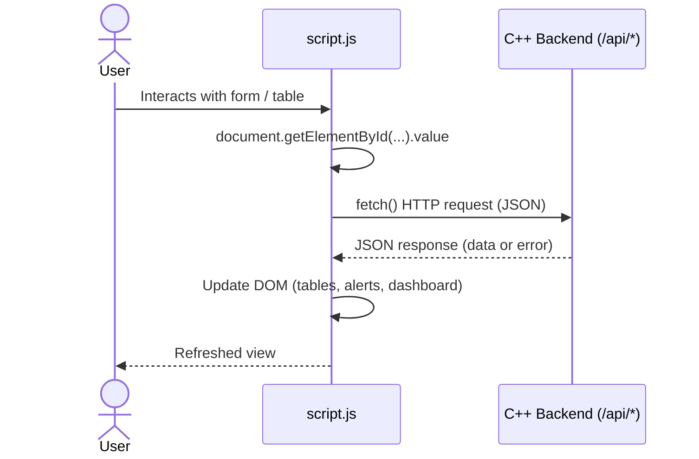

# Pharmatrix AI — Frontend

Browser-based UI for the Pharmatrix AI pharmacy inventory and operations platform. The frontend is a thin client: it collects and displays data, and does not execute business logic directly — the [C++ backend](../Backend/readme.md) owns all validation and rules.

> See the [project-level README](../readme.md) and [`Pharmatrix_AI_Project_Report.pdf`](../Pharmatrix_AI_Project_Report.pdf) for full context, roadmap, and feature scope.

## Responsibilities

- Render forms, tables, and a dashboard for pharmacy staff.
- Collect user input and send it to the C++ backend as HTTP requests.
- Display backend responses (inventory, sales, purchases, reports) without re-implementing business rules.
- Surface low-stock alerts, expiry warnings, and AI assistant responses to the user.

## How It Talks to the Backend



No request bypasses the backend: the browser never reads or writes data files/database directly.

## Planned File Layout

```
Frontend/
├── index.html    # Pages: dashboard, medicines, batches, sales, purchases, reports
├── style.css     # Styling
├── script.js     # Fetch calls, DOM updates, form handling
└── readme.md
```

## Planned Views

| View | Purpose |
|---|---|
| Dashboard | Low-stock alerts, expiry warnings, quick stats |
| Medicines | Create / search / update / deactivate medicine records |
| Batches | Batch-level stock: quantity, price, expiry |
| Sales | Record sales, view history and summaries |
| Purchases | Supplier info, purchase history, recommendations |
| Reports | Sales, inventory value, margin, fast/slow movers, expiry risk |
| Assistant | Natural-language Q&A powered by the LLM service, with explained recommendations |

## Development Status

Not yet started — the project begins with the backend's Phase 1 (C++ console foundation). Frontend work begins in **Phase 4 — Web frontend integration**, connecting forms and tables to the backend's HTTP endpoints. See the [roadmap](../readme.md#development-roadmap).

## Running Locally

> To be filled in once backend HTTP endpoints exist. Expected to be a static `index.html` served directly or via a lightweight dev server, pointed at the local backend's base URL.

```bash
# placeholder — e.g. open index.html directly, or:
npx serve .
```
