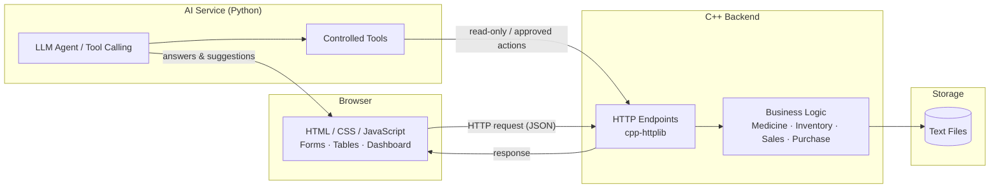
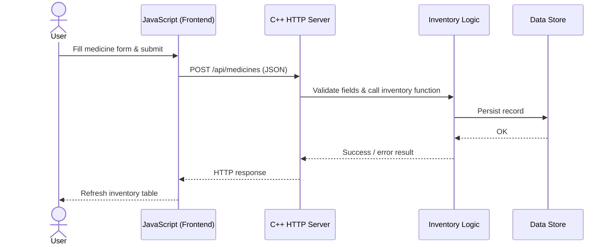
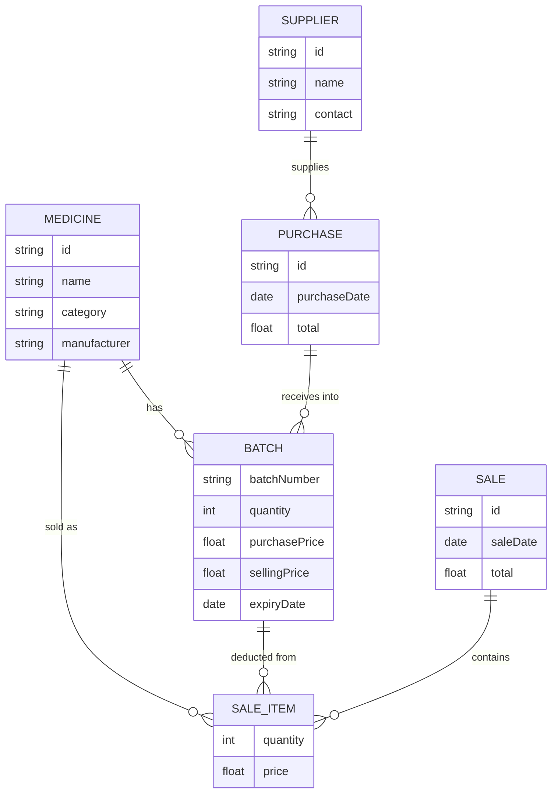
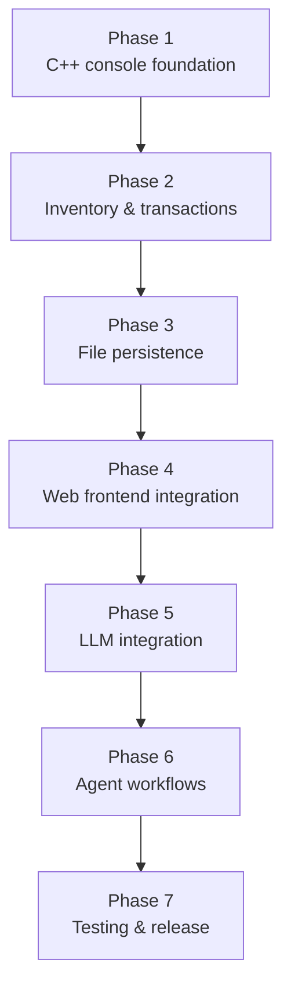

# Pharmatrix AI

**Intelligent Pharmacy Inventory & Operations Platform**

Pharmatrix AI is a pharmacy inventory and operations system being built in phases: a C++ business-logic core, a browser-based frontend, persistent storage, and — once the core is proven reliable — an LLM-powered assistant for analytics and reordering support.

> Status: early development (Phase 1 — C++ console foundation). This README reflects the full project plan described in [`Pharmatrix_AI_Project_Report.pdf`](./Pharmatrix_AI_Project_Report.pdf); not all features below are implemented yet.

---

## Table of Contents

- [Overview](#overview)
- [Problem Statement](#problem-statement)
- [Core Objectives](#core-objectives)
- [Architecture](#architecture)
- [Tech Stack](#tech-stack)
- [Feature Modules](#feature-modules)
- [Data Model](#data-model)
- [Business Rules](#business-rules)
- [Project Structure](#project-structure)
- [Development Roadmap](#development-roadmap)
- [Estimated Timeline](#estimated-timeline)
- [AI-Assisted Development Approach](#ai-assisted-development-approach)
- [Testing & Safety](#testing--safety)
- [Getting Started](#getting-started)
- [Sub-project Docs](#sub-project-docs)

---

## Overview

Small and medium pharmacies often rely on manual processes or basic software to track stock, sales, purchases, and expiry dates. This makes it harder to catch stock shortages early, flag batches nearing expiry, keep accurate records, and make purchasing decisions backed by sales history.

Pharmatrix AI brings these operations into one system: a C++ backend owns the business rules and data, a browser frontend collects and displays information, and a separate AI service can answer questions and propose actions — always subject to validation and human approval.

| Item | Plan |
|---|---|
| Product name | Pharmatrix AI *(proposed name; trademark/domain availability not verified)* |
| Category | Pharmacy inventory and operations platform |
| Core language | C++ |
| Frontend | HTML, CSS, JavaScript |
| Storage | Local text files |
| AI integration | Separate Python service, LLM API, controlled tools |

## Problem Statement

Manual or basic tooling makes it hard to:
- Notice stock shortages early
- Identify batches approaching expiry
- Maintain accurate, auditable records
- Make purchasing decisions grounded in sales history

Pharmatrix AI is a project proposal; workflows should be validated with real pharmacy staff before being treated as a production solution.

## Core Objectives

- Build a functional pharmacy inventory application in C++ using OOP.
- Manage medicines and individual batches (quantity, price, expiry).
- Record sales and purchases and keep stock consistent.
- Implement low-stock alerts, expiry monitoring, and FEFO batch selection.
- Connect a browser frontend to the C++ backend via local HTTP endpoints.
- Integrate an LLM assistant that uses controlled tools against real application data.
- Test, document, and package the application to portfolio quality.

## Architecture

The browser never executes C++ directly. JavaScript collects form input and calls a C++ HTTP server, which validates, applies business rules, persists data, and returns a response.



| Layer | Responsibility | Technology |
|---|---|---|
| Frontend | Forms, tables, dashboard, interactions | HTML, CSS, JavaScript |
| Backend | Validation, inventory rules, sales, purchases, reports | C++, cpp-httplib |
| Storage | Persist medicines, batches, sales, purchases, audit history | Local text files |
| AI service | LLM requests, tool selection, summaries, recommendations | Python, LLM API; LangGraph optional |

### Example data flow — Add a medicine



## Tech Stack

`C++` · `cpp-httplib` · `HTML` · `CSS` · `JavaScript` · `Text files` · `Python` · `LLM API` (LangGraph optional)

## Feature Modules

| Module | Highlights |
|---|---|
| **Medicine & Batch Management** | Create/view/search/update/deactivate medicines; track stock per batch (batch no., quantity, purchase/selling price, expiry) |
| **Inventory Management** | Receive stock, authorized adjustments, deduct on sale, block over-selling, reorder-threshold alerts |
| **Sales Management** | Record sales with date/items/quantities/prices, FEFO-aware batch deduction, sales history & summaries |
| **Purchase & Supplier Management** | Supplier details & history, received-stock recording, price comparison, purchase recommendations |
| **Expiry & FEFO Management** | Expired/near-expiry detection, configurable 30/60/90-day windows, at-risk stock valuation, FEFO selection |
| **Reporting & Analytics** | Daily/monthly sales, inventory value, purchase spend, gross margin, fast/slow movers, low-stock & expiry-risk reports |
| **LLM Assistant** | Natural-language Q&A over real data, summaries, transparent reorder suggestions, explained recommendations, tool-calling only (no direct DB/file edits) |

## Data Model

Stock is tracked at **batch level**, not just by medicine name, since each batch can carry a different expiry date, purchase price, and quantity.

| Medicine | Batch | Quantity | Expiry |
|---|---|---|---|
| Paracetamol 500 mg | P001 | 100 | 2027-03 |
| Paracetamol 500 mg | P002 | 200 | 2027-09 |



## Business Rules

- A sale must never reduce stock below zero.
- Every completed sale and purchase creates a transaction record.
- Stock deduction and sales recording succeed or fail together (writes to the text-file store are treated as a single atomic step).
- Expired batches are blocked from normal sale per approved policy.
- **FEFO** (First Expiry, First Out) selects the eligible batch with the earliest expiry date first.
- Every important stock adjustment records who made the change, when, and why.
- AI suggestions must be checked against current data and approved by an authorized user before any purchase or stock change.

## Project Structure

```
Pharmatrix-AI/
├── Frontend/          # index.html, style.css, script.js
├── Backend/           # main.cpp, Medicine.h/.cpp, Inventory.h/.cpp,
│                      # Sales.h/.cpp, Purchase.h/.cpp, httplib.h
├── data/              # inventory.txt, sales.txt, purchases.txt,
│                      # suppliers.txt, audit.txt (all persistence — no database)
├── ai-agent/          # main.py, agent.py, tools.py, prompts.py
├── Pharmatrix_AI_Project_Report.pdf
└── readme.md
```

The structure starts small and grows module-by-module as each roadmap phase lands.

## Development Roadmap



| Phase | Work | Deliverable |
|---|---|---|
| 1 — C++ console foundation | Classes, encapsulation, STL vectors, searching/sorting, file & exception handling | Console app: add/view/search/update/delete medicines |
| 2 — Inventory & transactions | Batches, stock receiving, sales, purchases, validation, FEFO logic | Functional inventory/sales/purchase engine |
| 3 — File persistence | Separate data files, safe I/O, validation, backup strategy | Data survives restarts |
| 4 — Web frontend integration | HTML/CSS/JS pages, C++ HTTP endpoints | Browser-based app powered by C++ |
| 5 — LLM integration | Python service, LLM API, structured outputs, tool design | Assistant answers questions over real data |
| 6 — Agent workflows | Tool selection, reorder proposals, report generation, approvals | Tool-using assistant with human approval gates |
| 7 — Testing & release | Unit/API tests, error handling, security checks, docs, deployment prep | Documented, demonstrable portfolio project |

## Estimated Timeline

Assumes ~2–3 focused hours/day with some AI-assisted coding (~30%) alongside hands-on implementation and debugging.

| Work area | Estimated effort |
|---|---|
| C++ console application | 4–6 days |
| Medicine & batch management | 4–5 days |
| Sales & purchase management | 3–4 days |
| File handling & validation | 2–3 days |
| HTML/CSS/JS frontend | 4–6 days |
| C++ ↔ frontend integration | 3–5 days |
| Expiry management & FEFO | 3–4 days |
| LLM integration | 4–6 days |
| AI agent & tool calling | 5–7 days |
| Testing & debugging | 4–6 days |

**Overall estimate: ~5–8 weeks** for a functional, tested project at 2–3 hrs/day. A polished, production-ready system may take longer.

## AI-Assisted Development Approach

AI is used as a coding assistant, not a substitute for understanding the system. The developer remains responsible for design, core logic, review, testing, and debugging:

- Use AI to explain unfamiliar C++ concepts and propose implementation options.
- Generate boilerplate, basic UI markup, and test-case suggestions where useful.
- Review every generated change and understand its impact on the codebase.
- Manually verify stock calculations, batch selection, and transaction behavior.
- Avoid accepting large unreviewed changes, especially around sales, inventory, and AI tool execution.

A ~30% AI-assisted / 70% hands-on split is a planning preference, not a guarantee — integration and debugging still take careful, manual effort.

## Testing & Safety

- Test duplicate medicines, invalid quantities, missing fields, unknown IDs.
- Test over-selling and confirm stock cannot go negative.
- Test multi-batch expiry scenarios and confirm correct FEFO selection.
- Test restart behavior to confirm records reload correctly.
- Test repeated/simultaneous requests before using real data.
- Protect local endpoints, validate all input — never expose an unauthenticated dev server to the public internet.
- Never treat an LLM as the authority for stock arithmetic, dispensing, dosage, drug interactions, or clinical decisions.
- The text-file storage model is a learning-project design choice, not a production pharmacy system — it has no concurrent-write protection or ACID guarantees that a database would provide.

## Getting Started

> Setup instructions will be expanded as each phase is implemented. See the sub-project READMEs for component-specific build/run steps.

```bash
git clone <repo-url>
cd Pharmatrix-AI
```

- Backend build/run instructions: [`Backend/readme.md`](./Backend/readme.md)
- Frontend setup instructions: [`Frontend/readme.md`](./Frontend/readme.md)

## Sub-project Docs

| Component | Description |
|---|---|
| [`Backend/`](./Backend/readme.md) | C++ business logic, HTTP API, data persistence |
| [`Frontend/`](./Frontend/readme.md) | Browser UI consuming the backend API |
| [`Pharmatrix_AI_Project_Report.pdf`](./Pharmatrix_AI_Project_Report.pdf) | Full project planning report (source of this README) |

---

## Project Vision

> Build the business logic first. Connect the frontend second. Make file-based storage reliable third. Add AI only after the core application can be trusted.
